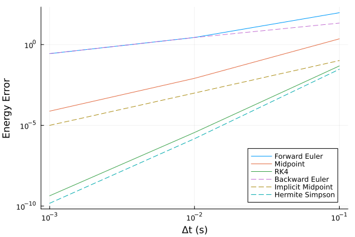

# 离散积分法

本文内容与 [微分方程的离散化](./微分方程的离散化.md) 有重合之处，需结合阅读。

## 概述

我们考虑如下连续系统：

$$
\dot{\mathbf{x}} = f(t,\mathbf{x})
$$

对于不显含时间 $t$ 的自治系统，上式可简化为 $\dot{\mathbf{x}}=f(\mathbf{x})$。

> 一般来说，描述一个系统的状态方程还会包括一个输入变量 $\mathbf{u}$ ，但在一个控制周期内，输入变量 $\mathbf{u}$ 不发生变化，可视为常量，因此我们不加以考虑。

我们要解决的问题是，已知离散积分的时间步长 $\Delta t$、当前时刻 $t_k$ 和状态量 $\mathbf{x}_k$ ，如何求解下一时刻的状态量 $\mathbf{x}_{k+1}$ ？这个问题在数值求解、模拟仿真中经常遇到。

解决该问题有两大流派：显式积分法和隐式积分法。显式积分法的计算方式为：

$$
\mathbf{x}_{k+1}=f_{\mathrm{explicit}}(t_k,\mathbf{x}_k,\Delta t)
$$

隐式积分法的计算方式为：

$$
f_{\mathrm{implicit}}(t_k,\mathbf{x}_{k+1},\mathbf{x}_k,\Delta t)=0
$$

两者最关键的区别是，$\mathbf{x}_{k+1}$ 是否在函数 $f$ 里面。如果“否”，我们就不用解方程，可以直接显式地计算出 $\mathbf{x}_{k+1}$；如果“是”，那我们还得解个方程。

总体而言，隐式积分法通常具有更好的数值稳定性，但计算复杂度也更高。下图是某个系统的实验结果，其中前向欧拉法和后向欧拉法的误差存在差异，主要与具体系统及步长有关。从方法本身看，两者的精度阶数是一致的，均为一阶。

{.img-center width=50%}

## 显式积分法

### 前向欧拉法

$$
\mathbf{x}_{k+1}=\mathbf{x}_k+\Delta t\cdot f(t_k,\mathbf{x}_k)
$$

把 $\mathbf{x}(t_{k+1})$ 在 $t_k$ 处一阶泰勒展开，用 $t_k$ 处的切线替代原函数。

### 中点法

$$
\begin{aligned}
\mathbf{x}_{\mathrm{mid}} &= \mathbf{x}_k+\frac{\Delta t}{2}\cdot f(t_k,\mathbf{x}_k)\\
\mathbf{x}_{k+1} &= \mathbf{x}_k+\Delta t\cdot f\left(t_k+\frac{\Delta t}{2},\mathbf{x}_{\mathrm{mid}}\right)
\end{aligned}
$$

### RK4

RK4，全称 4 阶 Runge-Kutta 法（龙格库塔法）。

$$
\begin{aligned}
k_1 &= \Delta t\cdot f(t_k,\mathbf{x}_k)\\
k_2 &= \Delta t\cdot f\left(t_k+\frac{\Delta t}{2},\mathbf{x}_k+\frac{k_1}{2}\right)\\
k_3 &= \Delta t\cdot f\left(t_k+\frac{\Delta t}{2},\mathbf{x}_k+\frac{k_2}{2}\right)\\
k_4 &= \Delta t\cdot f(t_k+\Delta t,\mathbf{x}_k+k_3)\\
\mathbf{x}_{k+1} &= \mathbf{x}_k+\frac{1}{6}(k_1+2k_2+2k_3+k_4)
\end{aligned}
$$

这里的 $k_1,k_2,k_3,k_4$ 表示各阶段的状态增量。

## 隐式积分法

隐式积分法的思路是先写出 $f_{\mathrm{implicit}}$，然后求这个函数以 $\mathbf{x}_{k+1}$ 为自变量时的零点。

很多时候我们无法形式化地求解方程，最常用的还是各类数值解法，比如牛顿法。

顺嘴提一句，很多库都能计算牛顿法所需的 Jacobian 矩阵，可以通过自动微分，或者使用前向差分、中心差分等数值方法来近似计算偏导数。

### 后向欧拉法

$$
\mathbf{x}_k+\Delta t\cdot f(t_{k+1},\mathbf{x}_{k+1})-\mathbf{x}_{k+1}=0
$$

把 $\mathbf{x}(t_k)$ 在 $t_{k+1}$ 处一阶泰勒展开，用 $t_{k+1}$ 处的切线替代原函数。

### 隐式中点法

$$
\begin{aligned}
\mathbf{x}_{k+\frac{1}{2}} = \frac{1}{2}(\mathbf{x}_k+\mathbf{x}_{k+1})\\
\mathbf{x}_k+\Delta t\cdot f\left(t_k+\frac{\Delta t}{2},\mathbf{x}_{k+\frac{1}{2}}\right)-\mathbf{x}_{k+1} = 0
\end{aligned}
$$

### Hermite-Simpson 法

$$
\begin{aligned}
\mathbf{x}_{k+\frac{1}{2}} = \frac{1}{2}(\mathbf{x}_k+\mathbf{x}_{k+1})+\frac{\Delta t}{8}[f(t_k,\mathbf{x}_k)-f(t_{k+1},\mathbf{x}_{k+1})]\\
\mathbf{x}_k+\frac{\Delta t}{6}\left[f(t_k,\mathbf{x}_k)+4f\left(t_k+\frac{\Delta t}{2},\mathbf{x}_{k+\frac{1}{2}}\right)+f(t_{k+1},\mathbf{x}_{k+1})\right]-\mathbf{x}_{k+1} = 0
\end{aligned}
$$